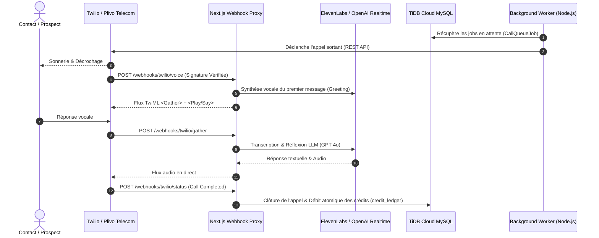

# 🛡️ CAHIER DES CHARGES & ARCHITECTURE SAAS — GETAUTOCALL.FR
*Plateforme d'Agents Vocaux IA Autonomes d'Entreprise*

---

## 📌 1. Cartographie de l'Écosystème & Sous-Domaines

| URL | Rôle | Target Path | Sécurité |
|---|---|---|---|
| **`https://getautocall.fr`** | Landing Page Commerciale Ultra-Premium | `/` | Cache Edge, CSP, HSTS 2 ans |
| **`https://app.getautocall.fr`** | Dashboard SaaS Client & Administration | `/app/dashboard` | JWT HttpOnly `cm_session`, RBAC, Isolation Tenant |
| **`https://docs.getautocall.fr`** | Documentation & API Reference interactive | `/docs` | Rendu Statique / CDN |
| **`https://status.getautocall.fr`** | Hub d'État du Système & Uptime 90 jours | `/status` | Sonde de santé temps réel |
| **`https://api.getautocall.fr`** | Passerelle API Développeurs (v1) | `/api/v1/*` | Clés API `cmk_*` chiffrées bcrypt + Rate Limit Redis/Cache |

---

## 🔐 2. Piliers de Sécurité & Isolation Multi-Tenant

### 2.1 Authentification & Sessions
- **Cookies HttpOnly & SameSite Lax** : `cm_session` (clients) et `cm_admin` (administrateurs) avec drapeau `Secure` automatique en HTTPS.
- **Zéro Mock en Production** : Interdiction formelle de fallback sur un compte fictif en cas d'erreur de base de données ou de session absente. Redirection stricte vers `/login`.
- **Protection contre le Brute-Force** : Limitation à 5 tentatives de connexion par e-mail + IP avec verrouillage exponentiel (`rate-limit.js`).

### 2.2 Scoping & Étanchéité des Données (Anti-IDOR)
- **Scoping Strict par `client_id`** : Toutes les requêtes Prisma sur les agents, contacts, campagnes, appels et clés API filtrent impérativement sur `where: { client_id: clientId }`.
- **Assertion de Propriété (`assertOwned`)** : Vérification systématique avant toute opération de lecture ou de modification.

### 2.3 Signatures Cryptographiques des Webhooks
- **Twilio** : Vérification via `X-Twilio-Signature` avec HMAC-SHA1 et comparaison en temps constant (`timingSafeEqual`).
- **Plivo** : Vérification via `X-Plivo-Signature-V3` avec HMAC-SHA256 et validation de nonce.
- **Stripe** : Vérification via `Stripe-Signature` (`t=...,v1=...`) avec HMAC-SHA256 et rejet des requêtes hors fenêtre de tolérance (300 secondes).

---

## ⚡ 3. Téléphonie & Moteur d'Appels IA

---

## 💳 4. Facturation Stripe & Grand Livre des Crédits

- **Unités & Devises** : Prise en charge automatique EUR / USD / XOF avec conversion propre des montants Stripe en centimes.
- **Transactions Atomiques avec Verrouillage (`SELECT ... FOR UPDATE`)** :
  - Chaque consommation de crédit (1 crédit = 1 minute commencée) est enregistrée dans `credit_ledger` au sein d'une transaction Prisma.
  - Le solde `balance_after` est garanti contre toute condition de concurrence (race conditions).
- **Règles de Rejet** : Tout débit conduisant à un solde négatif lève une exception `InsufficientCreditsError` et interrompt la file d'attente de numérotation.

---

## 🖥️ 5. Infrastructure & Haute Disponibilité (OVH VPS + Coolify)

- **Serveur** : VPS OVH `57.129.173.31` (Ubuntu 24.04 LTS).
- **Gestionnaire** : Coolify v4.3.23 (Docker autonome, healthcheck `/api/health`, rolling updates zéro interruption).
- **Conteneurs** :
  1. `autocall-web` : Next.js 16 Standalone (App Router, Proxy multi-domaines).
  2. `autocall-worker` : Worker de télécommunication autonome 24/7 (`scripts/worker.mjs`).
- **Base de Données** : Cluster TiDB Cloud MySQL managé avec chiffrement TLS et sauvegardes automatiques.
